# Learning ML in Python on astronomy data

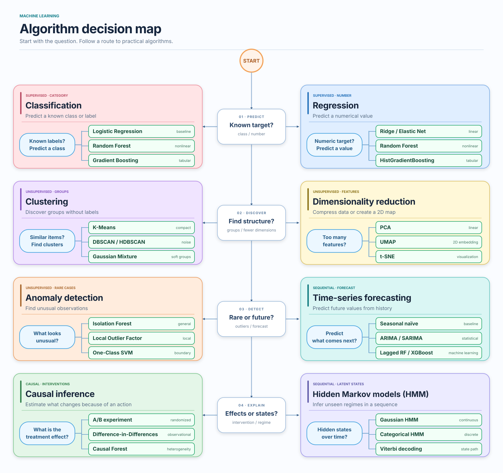

* [Recover the Pleiades](#pleiades-recover-a-star-cluster-clustering---dbscan-hdbscan) - clustering (DBSCAN, HDBSCAN)
  * [Parameters tuning for DBSCAN](#pleiades---parameters-tuning-for-dbscan)
  * [Compare ML models HDBSCAN vs DBSCAN](#compare-ml-models-hdbscan-vs-dbscan)
* [Find unusual Gaia stars](#pleiades-recover-a-star-cluster) - anomaly detection (IsolationForrest, LOF)
  * [Verification using SIMBAD](#verification-using-simbad) 
* [Visualize stellar populations](#pleiades-from-gaia-using-dimensionality-reduction-pca-umap) - dimensionality reduction (PCA, UMAP)
* [Classify variable stars](#supervised-learning---classifying-rr-lyrae-eclipsing-binaries-long-period-variables) - classification (logistic regression, random forest, gradient boosting)
* Classify white dwarfs
* [Predict stellar temperature](#predicting-stellar-temperature-with-regression) - regression (Linear, Random Forrest, Gradient Boosting)
* [Discover an exoplanet using TESS data](#discover-an-exoplanet-using-tess-data) - time-series, Box Least Squares
* Classify galaxy morphology - deep learning (CNN)
* Detect astronomical transients - time-series, anomaly detection
* [Orion constellation](https://github.com/dancewithheart/astronomy_visual#orion-constellation---data-exploration-and-visualisation) - data exploration and visualization
* Learning extraction from AI driven experiments

## Pleiades: recover a star cluster (clustering - DBSCAN, HDBSCAN)

```sh
python -m experiments.pleiades --refresh
```

Approach:
```
query Gaia dataset
-> pandas cleaning/filtering
-> feature selection
-> StandardScaler
-> run skylearn unsupervised learning - DBSCAN
-> visualise candidate cluster and data (results + noise): motion, sky, CMD (colour–magnitude sequence)
```

Results:
Gaia query returned: 720 sources (stars)
DBSCAN identified a single dense group
```
392 stars
median parallax = 7.361 mas
median pmra     = +19.749 mas/yr
median pmdec    = -45.370 mas/yr
```

From parallax distance is 1000 / 7.36 = 136 pc


* Proper-motion plot


The yellow DBSCAN cluster is a very compact blob around roughly (pmra, pmdec) ≈ (20, -45) while the field stars are widely dispersed. This is exactly the structure we hoped unsupervised clustering would recover.

* Sky plot


The yellow candidates are spread across most of 1° cone rather than forming an obvious dense central patch.
That looked like something worth investigate further:


* CMD


Cluster 0 forms a nice stellar sequence from hot/blue bright stars
down to cool/red faint stars.

That is nice evidence supporting claim that DBSCAN did not find accidental data.

### Pleiades - parameters tuning for DBSCAN

```
python -m experiments.pleiades_tune
```

After dropping conditions on parallex there are more data 4k sources
so the experiment become bore general (no bias towards parallex).

But across different parameters the same cluster is found:
```
parallax ≈ 7.36 mas
pmra     ≈ +19.72 mas/yr
pmdec    ≈ -45.32 mas/yr
```

After varying eps and in the best combination was eps=0.05 and min_samples=15
```
eps=0.05
min_samples=15

candidate size: 962
TP: 858
FP: 104
FN: 23

precision: 0.892
recall:    0.974
F1:        0.931
```
it improves initial parameter choice:
```
precision: 0.712 → 0.892
recall:    1.000 → 0.974
F1:        0.832 → 0.931
```

In data there is visible *precision–recall trade-off*
```
0.05 / 10 → precision .874, recall .984
0.05 / 15 → precision .892, recall .974   ← best F1
0.05 / 20 → precision .910, recall .936
0.05 / 30 → precision .916, recall .900
0.05 / 40 → precision .927, recall .846
...
```

### Compare ML models HDBSCAN vs DBSCAN

HDBSCAN was more robust to parameter choice but more permissive:
it consistently recovered all 881 reference members,
while including ~325–333 additional candidates.

Tuned DBSCAN sacrificed 23 reference members but reduced unmatched candidates to 104, producing a higher F1 score.

```
DBSCAN:
precision = 0.892
recall    = 0.974
F1        = 0.931

HDBSCAN:
precision = 0.731
recall    = 1.000
F1        = 0.844
```

### Research using this approach

* 2023 study used Gaia DR3 + DBSCAN on Pleiades, Praesepe and Blanco 1; it identified 958 Pleiades members: [A Gaia astrometric view of the open clusters Pleiades, Praesepe and Blanco 1 - Jeison Alfonso, Alejandro García-Varela - Astrometry & Astrophysics Vol 677](https://www.aanda.org/articles/aa/full_html/2023/09/aa46569-23/aa46569-23.html)
* 2024 study used Gaia DR3 + DBSCAN to twelve open clusters (NGC 2264, NGC 2682, NGC 2244, NGC 3293, NGC 6913, NGC 7142, IC 1805, NGC 6231, NGC 2243, NGC 6451, NGC 6005, NGC 6583) and validated the resulting memberships with colour-magnitude diagrams and spectroscopic data [Membership determination in open clusters using the DBSCAN Clustering Algorithm - Mudasir Raja, Priya Hasan, Md Mahmudunnobe, Md Saifuddin, S N Hasan](https://arxiv.org/abs/2404.10477)


## Pleiades: recover a star cluster

Find unusual objects in the colour–magnitude diagram (CMD)

```sh
python -m experiments.gaia_anomalies
```

Features:
* `bp_rp` - stellar colour, related to temperature
* `absolute_g_mag` - intrinsic brightness, estimated from parallax

```python
FEATURES = ["bp_rp", "absolute_g_mag"]
```

Use two methods:
* `IsolationForest` uses randomly generated decision trees. Observations that can be isolated with relatively few splits receive higher anomaly scores.
* `Local Outlier Factor` (LOF) asks a different question: is this point unusually isolated relative to its local neighbours?

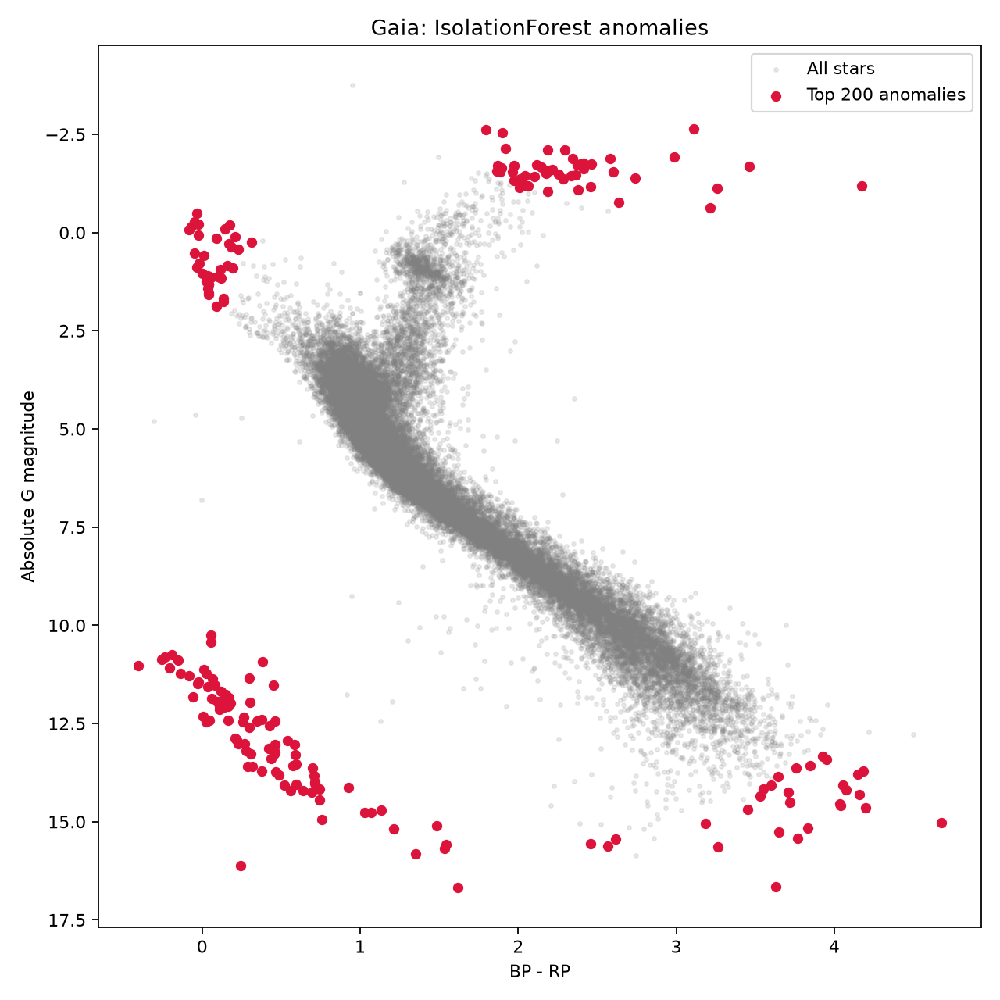

Three particularly interesting regions:
- Bottom-left: blue, intrinsically faint objects forming a sequence. These are consistent with the white-dwarf cooling sequence.
- Bottom-right: very red, intrinsically faint stars, plausibly low-mass M dwarfs and ultracool objects.
- Top-right: extremely luminous, red objects, potentially evolved giant stars, heavily reddened objects, or problematic measurements.

IsolationForest identifies entire rare populations, not necessarily individual objects.

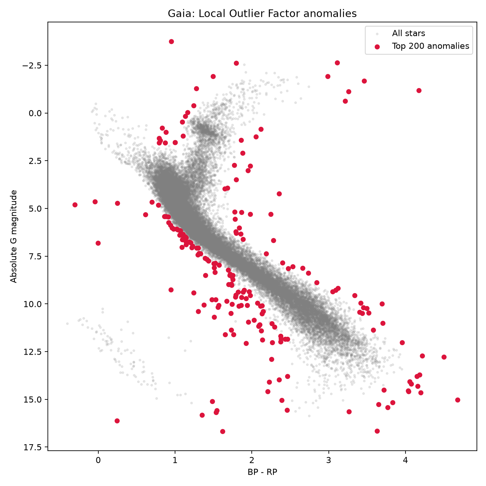

LOF tends to highlight stars that deviate from the local CMD structure, including objects between the main stellar sequences.


### verification using SIMBAD

```
python -m experiments.gaia_anomalies
```

Use AQL query
```sql
SELECT
    u.gaia_id,
    b.main_id,
    b.otype,
    b.otype_txt
FROM TAP_UPLOAD.candidates AS u
JOIN ident AS i
    ON i.id = u.gaia_id
JOIN basic AS b
    ON b.oid = i.oidref
```
to [query SIMBAD using astroquery](https://astroquery.readthedocs.io/en/latest/api/astroquery.simbad.SimbadClass.html) to check what is type of candidate anomalies
```sh
python -m experiments.gaia_anomaly_validate
```

| Column | Meaning |
|---|---|
| `source_id` | Gaia DR3 identifier |
| `method` | IsolationForest or LOF |
| `if_rank` | IsolationForest anomaly ranking |
| `lof_rank` | Local Outlier Factor ranking |
| `main_id` | SIMBAD's preferred object identifier |
| `otype` | Astronomical object-type code |
| `otype_txt` | Human-readable object classification |
| `simbad_found` | Whether an identifier match was found |

Summary:

| Metric | IsolationForest | LOF |
|---|---:|---:|
| Candidates | 200 | 200 |
| Matched in SIMBAD | **195 (97.5%)** | 88 (44%) |
| Confirmed white dwarfs (`WD*`) | 65 | 3 |
| White-dwarf candidates (`WD?`) | 23 | 2 |
| White dwarfs + candidates | **88 (44%)** | 5 (2.5%) |
| No exact SIMBAD match | 5 | 112 |

Example:

| Gaia DR3 source | IF rank | LOF rank | SIMBAD classification |
|---|---:|---:|---|
| [69975466908268416](https://simbad.cds.unistra.fr/simbad/sim-id?Ident=Gaia+DR3+69975466908268416&NbIdent=1&Radius=2&Radius.unit=arcmin&submit=submit+id) | 1 | 124 | White-dwarf candidate (`WD?`) |
| [64061503103122048](https://simbad.cds.unistra.fr/simbad/sim-id?Ident=Gaia+DR3+64061503103122048&NbIdent=1&Radius=2&Radius.unit=arcmin&submit=submit+id) | 7 | 28,730 | White dwarf (`WD*`) |
| [69886853143994496](https://simbad.cds.unistra.fr/simbad/sim-id?Ident=Gaia+DR3+69886853143994496&NbIdent=1&Radius=2&Radius.unit=arcmin&submit=submit+id) | 240 | 1 | Hot subdwarf (`HS*`) |

IsolationForest considers the white dwarf extremely unusual; LOF considers it entirely ordinary.
Why might that happen?
Because white dwarfs occupy a relatively distinct region of the CMD, yet form their own sequence. A star can therefore be globally unusual while locally surrounded by similar stars.

### Research

* [Gaia Data Release 3, Apsis. III. Non-stellar content and source classification](https://www.aanda.org/articles/aa/full_html/2023/06/aa43423-22/aa43423-22.html), Delchambre et al., 2022; Process 56 mln of sources using SOM.
* [Astronomaly: Personalised Active Anomaly Detection in Astronomical Data](https://arxiv.org/abs/2010.11202), Michelle Lochner, Bruce A. Bassett, 2021; combines anomaly detection with `active learning`. Tool using this approach: https://github.com/MichelleLochner/astronomaly

## Pleiades from Gaia using dimensionality reduction (PCA, UMAP)

```sh
python -m experiments.gaia_dimensionality --features 3
```

PCA and UMAP project Gaia measurements into two dimensions:
* `PCA` - linear projection, preserving maximum variance.
* `UMAP` - nonlinear projection, preserving local neighbourhoods.

Both reveal a distinct Pleiades population, verified against published members.

On UMAP there is small, detached group in the upper-right.

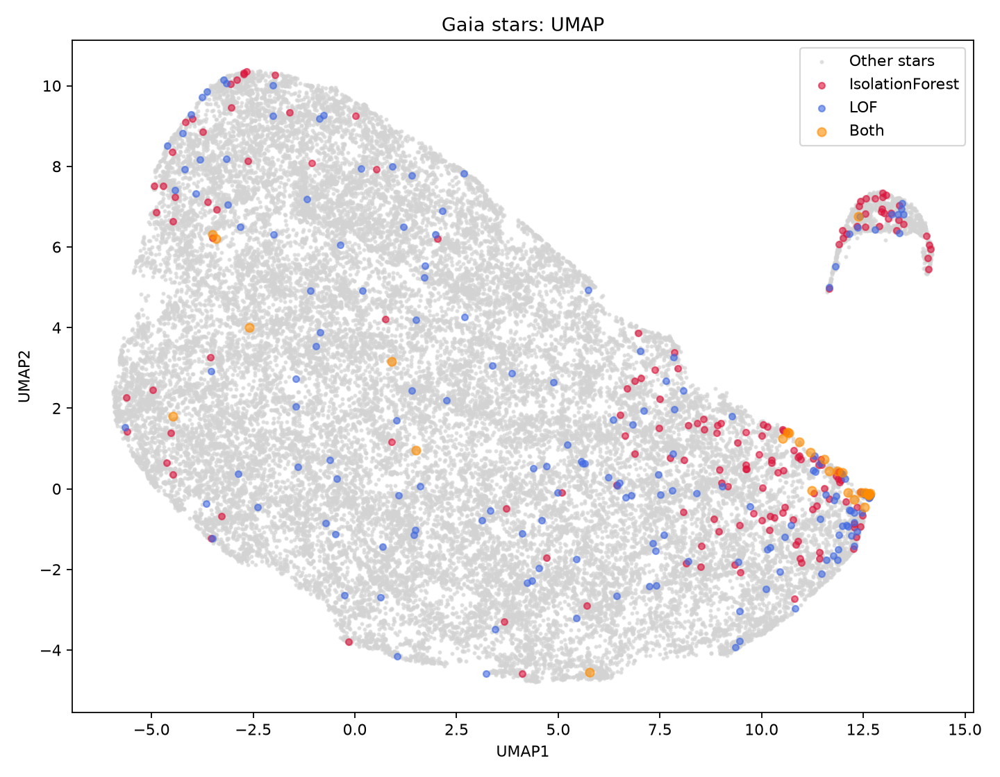

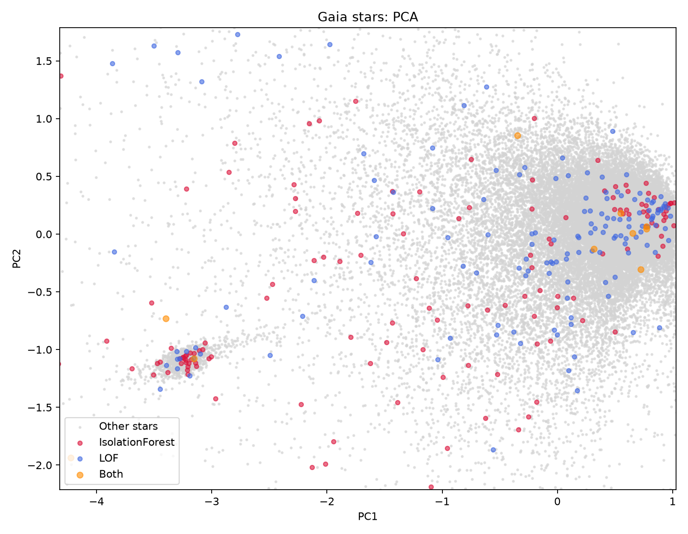

Validation and compare 3 vs 5 features:

```sh
python -m experiments.gaia_dimensionality --features 5
python -m experiments.gaia_dimensionality --features 3
python -m experiments.gaia_dimensionality_validate
```

Results:

| Method | 3 features | 5 features | Better |
|---|---:|---:|---|
| PCA, published-member 10NN | **86.9%** | 79.3% | 3D |
| UMAP, published-member 10NN | 86.4% | **89.5%** | 5D |
| PCA, proxy 10NN | **98.0%** | 84.5% | 3D |
| UMAP, proxy 10NN | **98.4%** | 92.8% | 3D |

PCA performs better with three features.
UMAP performs slightly better with five features against the published catalogue.

Here `10NN` measures `local neighbourhood purity`.

So **adding features does not necessarily improve a machine learning result. Their relevance depends on the algorithm and the objective**.

## Supervised learning - classifying RR Lyrae, eclipsing binaries, long-period variables

We will train model to detect following classes of variable stars:

| Code | Meaning | Why brightness changes |
|---|---|---|
| **RR** | RR Lyrae | The star periodically expands and contracts. |
| **ECL** | Eclipsing binary | Two stars orbit each other, periodically blocking their light. |
| **LPV** | Long-period variable | Usually evolved giant stars that pulsate over long periods. |

Codes and descriptions can be retried using AQL:
```sql
SELECT class_name, class_description
FROM gaiadr3.vari_classifier_class_definition
ORDER BY class_name
```

We use `supervised learning` we provide the correct labels during training. The algorithm learns to predict those labels for stars it hasn't seen before.

| Model | Macro-F1 | Interpretation |
|---|---:|---|
| Logistic Regression | 0.908 | Linear decision boundaries already work well |
| Random Forest | 0.955 | Nonlinear relationships improve classification |
| Gradient Boosting | **0.961** | Slightly better than Random Forest |

`Train/test split` - we provide the correct labels during training. The algorithm learns to predict those labels for stars it hasn't seen before.

`Confusion matrix`
Instead of simply asking whether the model is correct, we'll inspect which astronomical populations it confuses.

`RR Lyrae` (RR): 93% correctly classified.  
`Eclipsing binaries` (ECL): 98% correctly classified.  
`Long-period variables` (LPV): 96% correctly classified.  

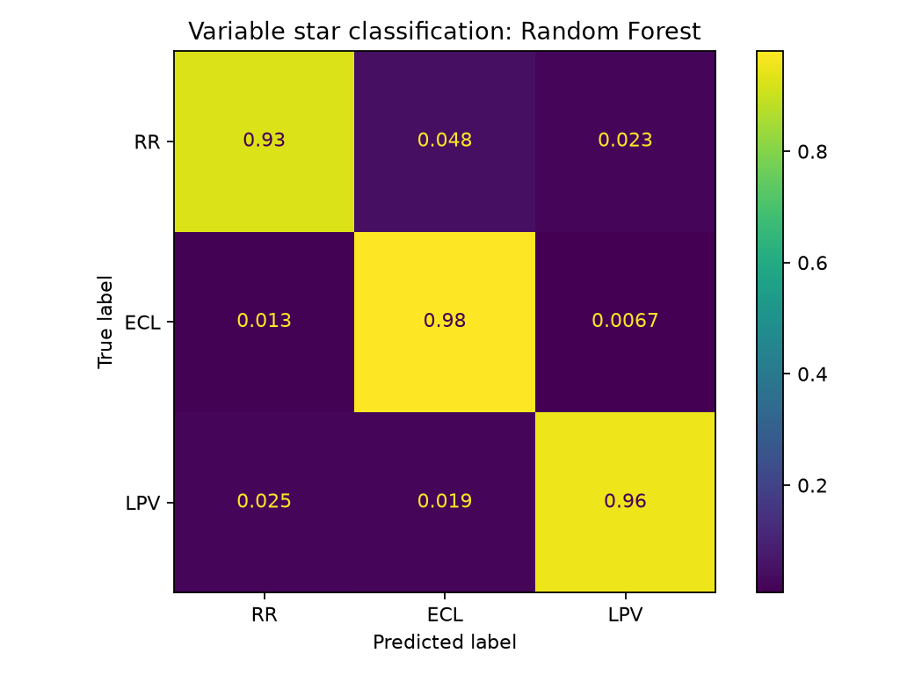

`Feature importance`: Does the model primarily use colour and brightness, or the measurements describing how brightness changes over time?

| Feature | Importance | Physical interpretation |
|---|---:|---|
| `skewness_mag_g_fov` | 0.256 | Asymmetry of brightness measurements |
| `bp_rp` | 0.190 | Stellar colour |
| `abbe_mag_g_fov` | 0.112 | Relationship between consecutive brightness measurements |
| `std_dev_mag_g_fov` | 0.037 | Amount of brightness variation |
| `phot_g_mean_mag` | 0.033 | Apparent brightness |
| `range_mag_g_fov` | 0.004 | Brightness range |

The most important measurement is not brightness itself, but the asymmetry of its distribution.

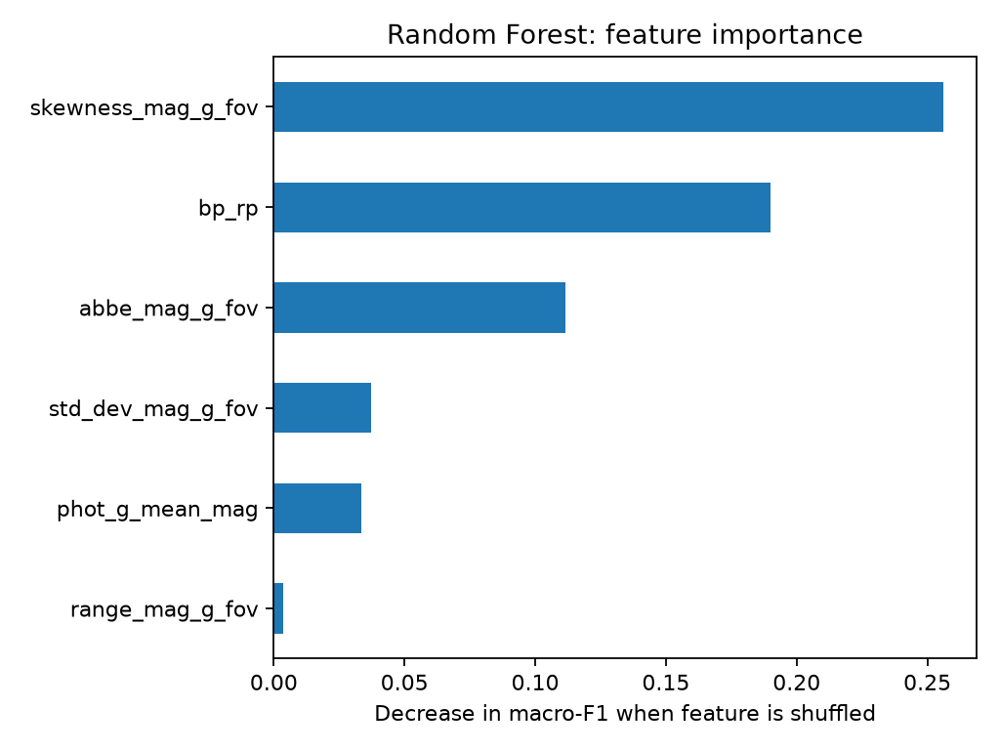

`feature ablation` measure how inptu variables contribute to predictive performance:

| Features | Macro-F1 |
|---|---:|
| Colour + brightness | 0.784 |
| Variability only | 0.916 |
| All six features | **0.955** |

## Predicting stellar temperature with regression

Can we estimate a star's surface temperature from its colour and luminosity?

We will compare models:

| Model | What it does | What we learn |
|---|---|---|
| Linear Regression | Fits a linear relationship | Baseline regression |
| Random Forest | Combines many decision trees | Nonlinear regression |
| Gradient Boosting | Builds trees that progressively correct errors | Improving predictions |


and evaluate them using MAE, RMSE, R², and residual plots.

| Metric | What it measures | Interpretation |
|---|---|---|
| MAE | Average absolute error | Typical size of a prediction error |
| RMSE | Root mean squared error | Penalizes large errors more strongly |
| R² | Improvement over predicting the mean temperature | 1 is perfect; 0 matches the mean baseline |

RMSE is particularly useful for identifying models that occasionally make very large mistakes.
Residual analysis
A residual is:
```
e(i) = predicted_temperature(i) - reference_temperature(i)
```
Here, positive residuals mean overestimated temperatures.
The code generates two diagrams.
predictions.png compares predicted temperatures against reference temperatures. Perfect predictions lie along the diagonal line.
residuals.png plots prediction errors against stellar colour.

Data used:

| Variable | Meaning | Role |
|---|---|---|
| `bp_rp` | Star's colour | Feature |
| `absolute_g_mag` | Intrinsic brightness | Feature |
| `teff_gspspec` | Spectroscopic temperature in Kelvin | Target |

```sh
python -m experiments.gaia_stellar_temperature --refresh
python -m experiments.gaia_stellar_temperature

# larger dataset
python -m experiments.gaia_stellar_temperature --radius 5
```

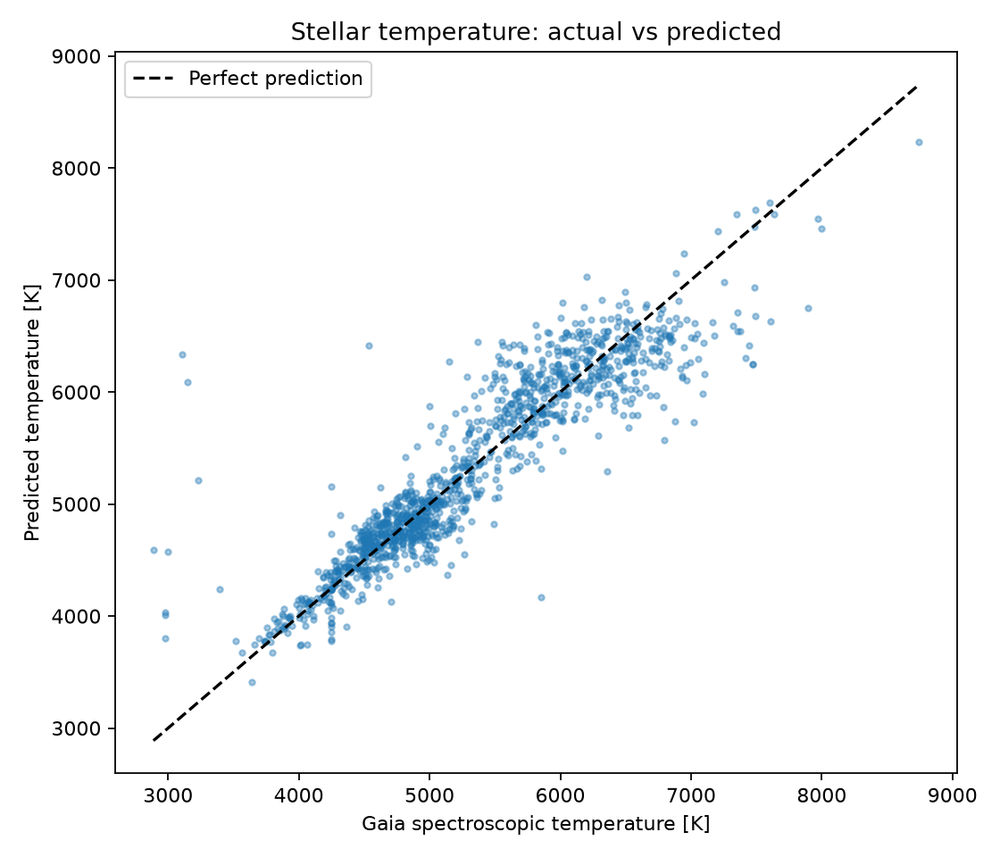

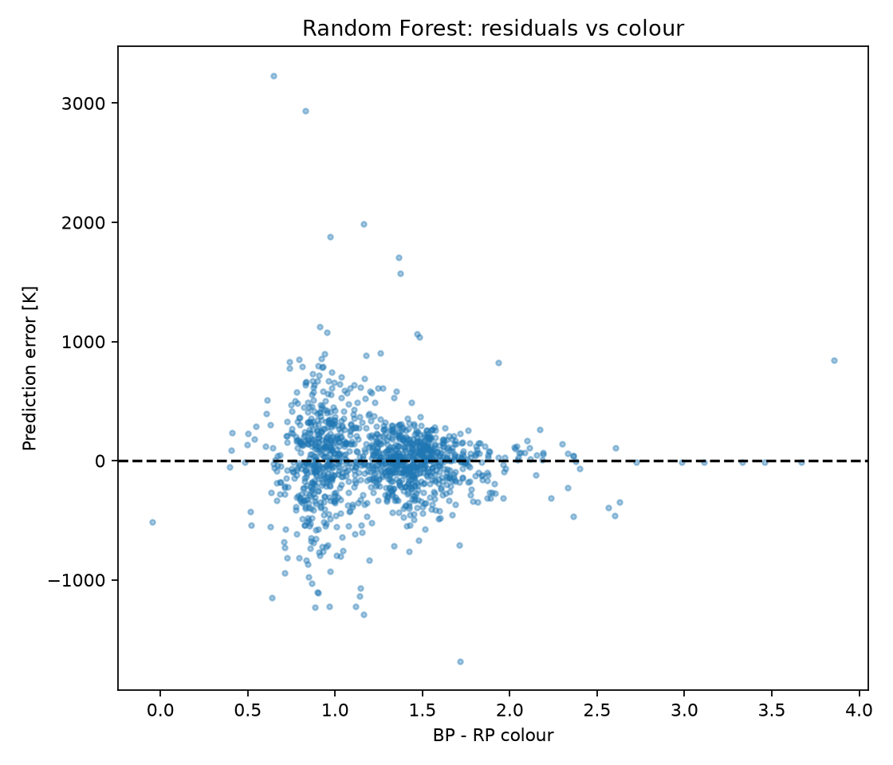


```sh
python -m experiments.gaia_temperature_outliers
```


```txt
Errors by temperature:

band                count   bias    mae
(0, 4000]              45  383.8  404.8
(4000, 4500]          155   26.6  131.9
(4500, 5000]          379   19.3  144.6
(5000, 5500]          190  -11.5  229.8
(5500, 6000]          205  152.8  262.1
(6000, 6500]          176   -1.0  226.4
(6500, 7000]          102 -315.1  346.2
(7000, inf]            33 -611.6  653.2
```

Observation 1: The model struggles at the extremes.
Below 4,000 K, MAE is 405 K. Above 7,000 K, it reaches 653 K.
But, these groups contain only 45 and 33 stars respectively.

Observation 2: The errors are systematic.
The bias changes direction.
- Cooler stars: predictions tend to be too hot.
- Hotter stars: predictions tend to be too cool.

## Discover an exoplanet using TESS data

Can Python detect a planet orbiting a distant star by measuring tiny, periodic decreases in its brightness?

Use NASA observations and try to recover [WASP-18 b](https://exoplanetarchive.ipac.caltech.edu/overview/WASP-18) exoplanet orbital period
without givin this period to the detection algorithm.

TESS repeatedly measures the brightness of stars.
When a planet passes between us and its star, some of the starlight is blocked.
The brightness decreases temporarily.

Algorithm - [Box Least Squares](https://docs.astropy.org/en/stable/timeseries/bls.html) (BLS)

```sh
python -m experiments.tess_transits
```

```text
[TESS] cadences=18,299, span=27.41 days
[TESS] scatter (robust)=0.75 ppt
[BLS] searching for periodic transit-shaped dips...

[BLS] best transit candidate
  period_days:        0.941479
  duration_hours:     1.92
  depth_percent:      0.987
  depth_snr:          491.3 (approximate)
  constant_RMSE_ppt:  2.95
  transit_RMSE_ppt:   0.83 (in-sample)

[Validation] compared AFTER fitting
  published_period:   0.9414524 days
  period_error:       0.04 minutes
```


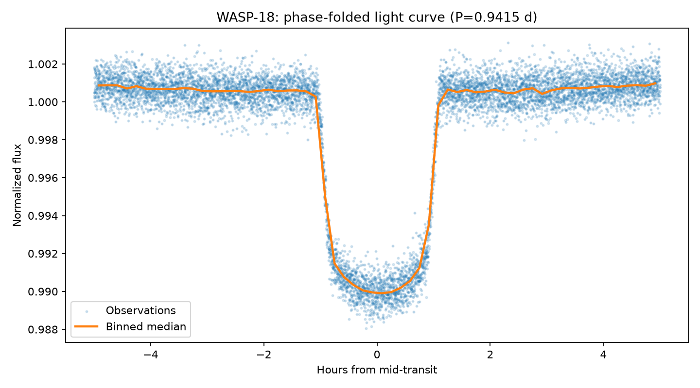

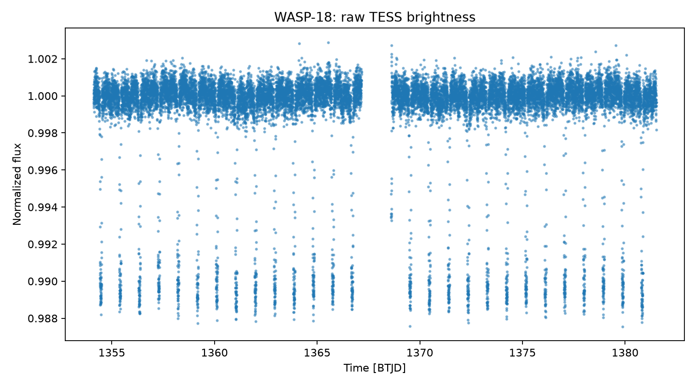

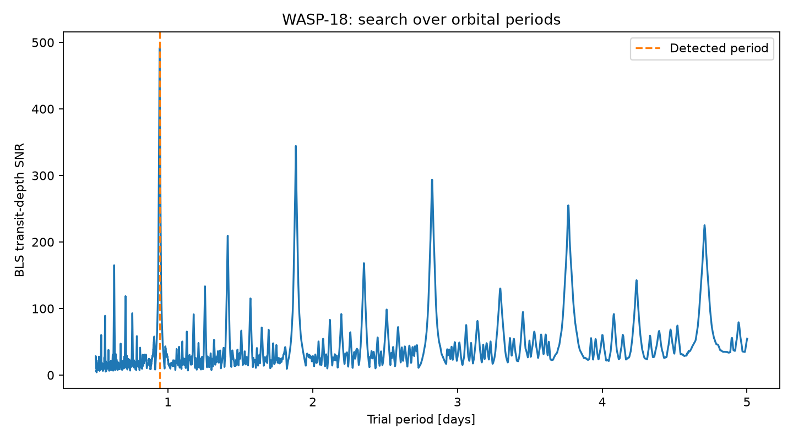

Using 18,299 TESS brightness measurements spanning 27.4 days,
a Box Least Squares search recovered the known orbital period of WASP-18 b
to within 2.3 seconds of its published value.
The transit model reduced in-sample RMSE by approximately 45%.
The periodogram also revealed strong harmonics of the orbital period.

### Box Least Squares vs Lomb–Scargle

| Algorithm | Assumed signal |
|---|---|
| Box Least Squares | Periodically recurring dips |
| Lomb–Scargle | Approximately sinusoidal periodic variation |

```text
[Lomb-Scargle] best periodic signal
period_days: 0.942123
difference_from_BLS_minutes: 0.93
```

| Algorithm | Detected period | Error vs published |
|---|---:|---:|
| Box Least Squares | 0.941479 days | **2.3 seconds** |
| Lomb–Scargle | 0.942123 days | **58 seconds** |

BLS recovered the published period more accurately in this experiment.

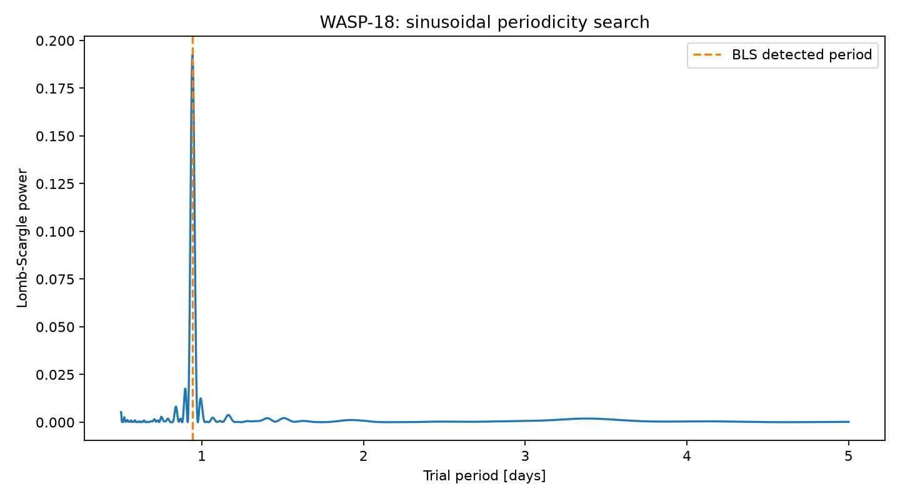

### Does signal shape determine the best algorithm?

BLS versus Lomb–Scargle on two different astronomical phenomena.

| Target | Physical phenomenon | Expected signal | Hypothesis |
|---|---|---|---|
| WASP-18 b | Planet passing in front of its star | Repeated brightness dips | BLS should fit better |
| HD 42608 | δ Scuti pulsating star | Approximately sinusoidal oscillations | Lomb–Scargle should fit better |

HD 42608 is used in [lightkurve tutorial](https://lightkurve.github.io/lightkurve/tutorials/3-science-examples/asteroseismology-oscillating-star-periodogram.html).

```sh
python -m experiments.tess_signal_shapes
```

```
[WASP-18 (transit)] cadences=18,299, train=13,724, test=4,575
[WASP-18 (transit)] frequency search=0.2–2.0 cycles/day
  baseline_test_RMSE_ppt: 2.933
  LS:  period=0.941847 d  test_RMSE=2.595 ppt
  BLS: period=0.941581 d  test_RMSE=0.844 ppt
  best_holdout_fit: BLS

[HD 42608 (pulsation)] cadences=14,629, train=10,971, test=3,658
[HD 42608 (pulsation)] frequency search=35.0–60.0 cycles/day
  baseline_test_RMSE_ppt: 1.825
  LS:  period=0.018596 d  test_RMSE=1.470 ppt
  BLS: period=0.018596 d  test_RMSE=1.564 ppt
  best_holdout_fit: LS

[Summary: held-out RMSE; lower is better]
              target  baseline_test_rmse_ppt  ls_test_rmse_ppt  bls_test_rmse_ppt
   WASP-18 (transit)                   2.933             2.595              0.844
HD 42608 (pulsation)                   1.825             1.470              1.564
```

The results support our hypothesis: an algorithm performs better when its assumptions match the physical phenomenon.

### Related research
* [ALeRCE light curve classifier: Tidal disruption event expansion pack](https://www.aanda.org/articles/aa/full_html/2025/04/aa51951-24/aa51951-24.html) - Pavez-Herrera et all - 2024

## Orion constellation - data exploration and visualisation

```sh
python -m experiments.orion.analysis
python -m experiments.orion.analysis --refresh
```

Gets astronomy data from Gaia DR3 data source about stars around [Orion](https://en.wikipedia.org/wiki/Orion_(constellation)):
- distance distribution


- color vs distance


- parallax measurement quality


```sh
python -m experiments.orion.pyvista --mode screenshot --quality draft
python -m experiments.orion.pyvista --mode screenshot --quality final
python -m experiments.orion.pyvista --mode mp4 --quality final
python -m experiments.orion.pyvista --mode interactive --quality preview
```

on Ubuntu, PyVista needed OpenGL libraries:

```bash
sudo apt-get install -y libgl1 libglx-mesa0 libegl1
```

Renders those Orion constellation in 3D using:
- distances computed from parallax
- Gaia BP−RP colours
or open interactive mode.

The current nebula dust is artistic - Gaussian blobs around bright stars and AI-tuned warm/cool gradients.


Interactive Plotly visualization (should open on http://127.0.0.1:43701/):

```bash
python -m experiments.orion.flythrough
```


